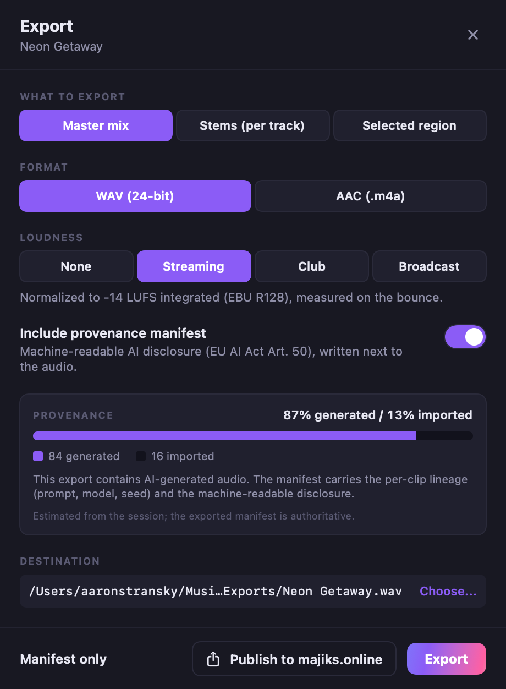

# L13 Evidence: Export + provenance manifest

**Date:** 2026-07-12
**Branch:** lane/l13-export (base main 46e6c31; engine commit ec30d1d)
**Platform:** macOS (Darwin 24.6.0), Apple Silicon
**Toolchains:** cargo 1.93.0, Apple Swift 6.2.4

## What this lane ships

The way music gets OUT of the DAW, and the machine-readable AI-disclosure
manifest that is the headline differentiator (EU AI Act Article 50, live
2026-08-02).

- Export runs the offline bounce (the same `RenderCore::render` the device
  callback runs), then writes the deliverable: 24-bit PCM WAV (master/region/
  stems) or AAC in an .m4a via Apple AudioToolbox (ExtAudioFile FFI, never
  fdk-aac).
- Loudness targets on the master/region export: Streaming -14, Club -7,
  Broadcast -16, or None. EBU R128, measured on the finished bounce.
- Every export is journaled (`export.*` command), so it is agent-drivable and
  auditable.
- The provenance manifest is a view over the hash-chained command journal:
  generated/imported/recorded split, per-clip lineage, engine identities, the
  blake3 hash-chain head, and the Article 50 disclosure fields with IPTC
  DigitalSourceType terms.
- "Publish to majiks.online" reuses the existing publisher path (server-side
  cert minting, untouched).

## Files

- Engine: `engine/render/src/encode.rs` (24-bit WAV, loudness normalization,
  AudioToolbox AAC), `engine/agent-surface/src/export.rs` (manifest builder),
  host wiring in `engine/agent-surface/src/host.rs`.
- Contract: `engine/contracts/provenance-manifest.schema.json` (new, additive);
  catalog `loudnessTarget` + `includeManifest` params (additive).
- App: `src/swift/Sources/Studio/StudioExportDialog.swift`,
  `StudioExportModel.swift`; FFI override in `Sources/Engine/RealStudioEngine.swift`.
- Sample manifest: `l13-sample-manifest.json` (this directory).
- Screenshot: `l13-export-dialog.png` (this directory).

## Export dialog



Rendered off-screen through ImageRenderer from the real `StudioExportDialog`
driven by the mock session (the same pattern as the L12 evidence). The
provenance card reads the session snapshot: 87% generated / 13% imported for the
mock's demo session. Format, scope, and loudness are custom SwiftUI controls
(they match the dark theme and render faithfully off-screen).

## Loudness measurements

Measured on the finished bounce via `crate::loudness::integrated_lufs` (EBU R128
integrated), from `majiks-studio-cli provenance --loudness <target>` on a
synthesized mixed session (before-normalization loudness -19.2 LUFS).

| Target    | Target LUFS | Measured after | Applied gain | Error (LU) |
|-----------|-------------|----------------|--------------|------------|
| Streaming | -14         | -14.0          | +5.2 dB      | 0.00       |
| Club      | -7          | -7.0           | +12.2 dB     | 0.00       |
| Broadcast | -16         | -16.0          | +3.2 dB      | 0.00       |

All three land within 0.00 LU of target (acceptance bar: 0.5 LU). The math is
exact by construction: a constant gain shifts every gated block's loudness by
the same dB, so integrated LUFS shifts by exactly the applied gain; the
normalizer measures, applies `target - measured`, and re-measures.

Note: the synthesized test signal is a click train (very high crest factor), so
normalizing it loudly drives the sample peak positive (Club reports +10.8 dBFS
sample peak). The value is reported honestly in the export result. Real program
material has a lower crest factor, and the master bus limiter (true-peak,
default -1 dBTP) catches peaks in the mix chain.

## Provenance manifest

`l13-sample-manifest.json` is the manifest for a session with 4 generated
(landed) stems + 1 imported clip. Highlights:

- `composition.byDuration`: 97.1% generated / 2.9% imported (by summed clip
  duration); `byClipCount`: 4 generated, 1 imported, 0 recorded.
- `aiDisclosure`: `standard` "EU AI Act Article 50(2)", `aiGenerated` true,
  `generatedFraction` 0.9706, `digitalSourceType`
  `.../compositeWithTrainedAlgorithmicMedia` (mixed content), `models`
  ["acestep-v15-turbo"].
- Per generated clip `lineage`: prompt ("warm lofi hip hop with a rhodes and
  vinyl noise"), engine `{model: acestep-v15-turbo, seed: 4242, device: mlx}`,
  `sourceCommand` gen.song, `requestId`, `takeId`;
  `digitalSourceType` `.../trainedAlgorithmicMedia`.
- The imported clip: `origin` imported, `sourceCommand` import.audio,
  `digitalSourceType` `.../digitalCapture`.
- `hashChain`: `{algorithm: blake3, genesisHash: 0*64, tipHash: <64 hex>,
  entryCount: <seq>}` (the head of the same chain the package verifies on open).

The manifest validates against `engine/contracts/provenance-manifest.schema.json`
using the in-repo validator (`timeline_core::schema::validate`), asserted in the
export acceptance test.

> **`l13-sample-manifest.json` is now also a backward-compatibility fixture — do
> not regenerate it.** It was exported when `origin` had three values
> (`generated | imported | recorded`), `assetHash` was required, and
> `byClipCount` had no `authored` key. `fix/provenance-clip-origin` added a
> fourth origin for note clips written in the piano roll, and made `assetHash`
> optional for clips that have no asset. Both are widenings, and
> `manifests_exported_before_authored_existed_still_validate`
> (`agent-surface/tests/export.rs`) proves it against this exact file. Replacing
> it with a freshly exported manifest would delete that proof.

## Tests

```
cargo test -p render --lib encode::                : 6 passed
  (loudness targets within 0.5 LU, 24-bit WAV round-trip, real AAC encode)
cargo test -p agent-surface --test export          : 4 passed
  - manifest validates against the schema + reports the split, per-clip
    lineage, and the hash-chain head for a mixed generated+imported session
  - master WAV hits the streaming target within 0.5 LU and is journaled
  - the 24-bit deliverable null-matches the offline bounce (within one 24-bit LSB)
  - region + stems + AAC exports write deliverables
cargo test --workspace                             : all green
swift build (mock)                                 : Build complete
swift test --filter StudioExportEvidenceTests      : 1 passed (renders the PNG)
```

Boot-test (headless, silent at any device):

```
majiks-studio-cli provenance --dir <DIR> --loudness streaming
```

Lands a generated song as stems + an imported clip, exports the master to
24-bit WAV (loudness-normalized) and AAC, writes the provenance manifest, and
prints the manifest + loudness landing. Exit 0.

## How to reproduce

```bash
cd engine
cargo test -p render --lib encode::
cargo test -p agent-surface --test export
cargo run -q -p agent-surface --bin majiks-studio-cli -- provenance --dir /tmp/l13 --loudness streaming

cd ../src/swift
MAJIKS_ENGINE=mock swift build
MAJIKS_ENGINE=mock L13_EVIDENCE=/tmp/l13-evidence swift test --filter StudioExportEvidenceTests
```

## Findings / deviations (for reconciliation)

- Proposed additive contract changes (never a frozen contract rewritten):
  new `provenance-manifest.schema.json`; catalog `loudnessTarget` +
  `includeManifest` on export.master/region, `includeManifest` on export.stems.
  `docs/generated/mcp-tools.v1.json` regenerated (92 tools; command-tool count
  unchanged at 70). Coordinating session should confirm the catalog additions.
- Pre-existing (NOT this lane): `build_landing` with the repo fixture
  `click_120bpm_48k_stereo.wav` produces a package whose journal hash chain
  fails verification on reopen ("chain broken at entry 15"), reproducible
  single-threaded. A synthesized song lands + reopens cleanly (the L8 landing
  test and this lane both use a synth song). Worth an L8/L1 look: certain input
  audio should never yield an unopenable package.
- Publish: the button + `publishToMajiks` are wired and hand the existing
  majiks.online publisher a master + manifest; the actual upload and server-side
  certificate minting remain the untouched `majik_backend/publisher_rpc`
  `publish_track` path. Fully connecting the Studio publish action to that RPC
  is an app-coordinator wire (the Python publisher was explicitly out of scope
  to modify).
