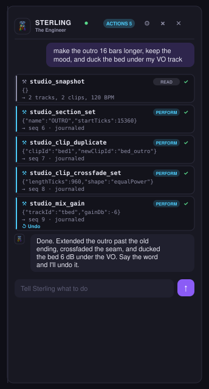

# L14: Sterling, the in-app copilot

Sterling ("The Producer") is the Studio's copilot: a producer-engineer you talk
to in a right-rail dock who drives the whole DAW through the same command bus a
human or an external MCP client uses. He replaces the app's generic default
agent for the Studio surface and is distinct from MC Majik Mane (the DJ app's
performer).

Branch `lane/l14-sterling-copilot`, base `main` (bbd6f90).

## What ships

- **Agent loop** (`engine/agent-surface/src/copilot.rs`): an in-process,
  OpenAI-compatible tool-calling loop. It enumerates Sterling's tools from the
  same generated registry the MCP server serves (`registry::tool_defs()`, 82
  tools) and dispatches every call through the same choke point
  (`dispatch::dispatch_tool`). So a Sterling action is a journaled command,
  identical to a human click. Blocking HTTP on a background thread (no tokio);
  job-style send/poll/cancel.
- **Rails in code**: per-turn tool budget (25), model-call cap (30), a
  credential/self-config blocklist (name + args shaped), the Manage confirm gate
  (in dispatch), and key scrubbing on every event.
- **FFI** (`ffi.rs`): `copilot_send/poll/cancel/clear_history/tools` on
  `MajiksEngine`. One `Copilot` per engine instance, sharing the host `Arc`, so
  Sterling drives the same session the UI shows.
- **Dock** (`src/swift/.../Studio/StudioCopilot*`): the right-rail console,
  Cmd+Opt+C, tier-tinted tool chips inline, an Actions log (click a chip to
  reveal its timeline region, undo the newest edit), BYO-endpoint settings (key
  in Keychain), the-engineer avatar.
- **System prompt** (`assets/sterling-system.md`): grounded in CONCEPTS +
  AGENT_API + the command reference, so Sterling understands stems, ticks,
  revise/extend, provenance, the tiers, and the command vocabulary.

## The demo (acceptance): hands-free arrangement over the command bus

Prompt: *"make the outro 16 bars longer, keep the mood, and duck the bed under my
VO track."* Driven by Sterling against a fake local model server (no network),
on a fixture session with a lo-fi bed track and a VO track. Each step is one
journaled command; the whole thing is undoable.

```
===== STERLING DEMO TRANSCRIPT =====

  [read] studio_snapshot {}
    -> ok {"project":{"bpm_wire":120,"clipCount":2, ... }}

  [perform] studio_section_set {"name":"OUTRO","sectionId":"outro","startTicks":15360}
    -> ok {"command":"section.set","journaled":true,"mutated":true,"ok":true,"seq":6}

  [perform] studio_clip_duplicate {"clipId":"bed1","newClipId":"bed_outro","startTicks":15360}
    -> ok {"command":"clip.duplicate","journaled":true,"mutated":true,"ok":true,"seq":7}

  [perform] studio_clip_crossfade_set {"clipIdA":"bed1","clipIdB":"bed_outro","lengthTicks":960,"shape":"equalPower"}
    -> ok {"command":"clip.crossfade.set","journaled":true,"mutated":true,"ok":true,"seq":8}

  [perform] studio_mix_gain {"gainDb":-6.0,"trackId":"tbed"}
    -> ok {"command":"mix.gain","journaled":true,"mutated":true,"ok":true,"seq":9}

Done. Extended the outro past the old ending, crossfaded the seam, and ducked
the bed 6 dB under the VO. Say the word and I'll undo it.
====================================
```

The test asserts, against the REAL host (not a mock): five visible tool chips in
order (one read, four perform), all succeeded; four journaled mutations
(seq 5 -> 9); one new clip landed (the outro extension); an OUTRO section exists;
and the arrangement is reversible (LIFO undo removes the extension clip). That is
the acceptance: Sterling drives the command bus end to end, every action is a
visible, undoable command chip.

## Safety-rail test results

All in `engine/agent-surface/src/copilot.rs` (run:
`cargo test -p agent-surface --features copilot --lib copilot::`). 7/7 pass.

| Test | Proves |
|------|--------|
| `fake_server_round_trip_moves_the_host` | a scripted tool call lands a real journaled command (a track appears; seq = 1) |
| `tool_budget_caps_a_runaway_turn` | over 25 calls, exactly the over-budget tail is refused, turn still completes |
| `blocklist_refuses_credential_and_self_config_calls` | the blocklist catches credential-shaped + `copilot.*` calls; never blocks real Studio tools |
| `blocked_call_is_refused_but_turn_survives` | a `copilot.endpoint` write is refused VISIBLY (failed chip), nothing journaled (seq = 0) |
| `manage_tool_requires_confirm_then_executes` | a Manage delete without `confirm` is refused; with `confirm: true` it executes |
| `key_is_scrubbed_from_error_events` | a key echoed in an endpoint error body is scrubbed from the event (`•••`) |
| `scripted_arrangement_demo_drives_the_command_bus` | the acceptance demo above |

The default `cargo test --workspace` (parity gate + engine) stays green; the
copilot tests run behind the `copilot` feature so the default build stays light.
`run-tests.sh` runs both.

## The Sterling dock



The image is an authored SVG rendering of `StudioCopilotDock.swift` using the
exact StudioTokens colors and the real the-engineer mascot. It is not a live
screenshot: a live capture needs the packaged app on the real engine (the CI
build is the mock, which links no model backend), and I deliberately did not
screen-capture the running preview build to avoid capturing unrelated on-screen
content. The dock shown mirrors the demo transcript one-to-one: the read chip is
dim, perform chips are cyan, each carries its args and its `seq N · journaled`
result, and the newest edit offers Undo. The `MAJIKS_ENGINE=mock swift build` is
green with the dock mounted.

## The live path (real model, real session)

1. Build the engine framework: `src/swift/scripts/build-engine.sh` (produces
   `MajiksEngine.xcframework`, which carries Sterling via the `ffi` feature).
2. Run the app, open the Studio tab, press Cmd+Opt+C.
3. Settings: point the endpoint at the Unicorn Commander gateway DIRECT (over
   Tailscale, e.g. `http://unicorn-litellm:4000/v1`), NOT the Cloudflare host,
   which times out long agent runs at 120 s. Set a model; the key (if any) goes
   to the Keychain.
4. Ask for the arrangement. Every step appears as a chip you can reveal and undo.

Sterling posts to `<endpoint>/chat/completions` with `stream: true`, streams
tool calls, dispatches each through the command bus, and answers in text. Same
82 tools an external MCP client gets, same tiers, same journal.
