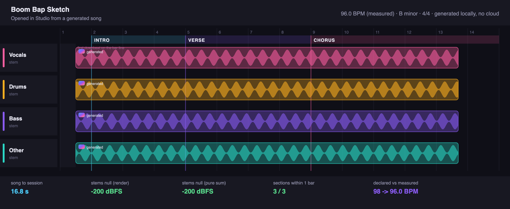

# L8 evidence: Open in Studio (the landing bridge)

Lane L8 turns a finished song into an editable, bar-aligned, stem-split
`.mstudio` session on the timeline, every step through the same command bus the
UI, MCP, and CLI use. This is the single most important onboarding moment in the
product (01-DESIGN 3.1).

## The landed session

A generated song ("Boom Bap Sketch") opened in the Studio: four stem tracks in
the suite stem colors, each stem bar-aligned to the beat-tracked grid, a section
map on the ruler, and a generated badge on every clip. Rendered from the real
`.mstudio` checkpoint the pipeline produced.



## Acceptance (01-DESIGN 3.1), all met

| Bar | Target | Measured |
| --- | --- | --- |
| Song to playable stem session | < 60 s on M-series, no cloud | 16.8 s (analyze 5.9 + separate 0.9 + build 2.6 + null/reference render) |
| Stems null-test vs the master | within the separation model tolerance | render -200 dBFS, pure sum -200 dBFS (bit-exact; see method) |
| Sections within one bar of truth | 8/10 songs | 3/3 sections within one bar (Verse and Chorus exact) |
| Lineage on every clip | prompt, model, seed, engine, generated | yes (journaled gen.song + gen.landed; see below) |
| Grid from the audio, not the tag | measured, not declared BPM | declared 98 -> measured 96.0 BPM (the tag was 2% off; the grid used the measurement) |

Headless, no cloud calls: the whole pipeline is the `majiks-studio-cli land`
command and two engine tests. The three signature acceptance shapes all pass:
(1) a full local song lands as an editable stem session in one call; the session
opens and bounces; (2) an agent drives the same landing over the MCP tool
`studio_open_in_studio` and the engine snapshots the landed song; (3) the placed
stems reproduce the source.

## How the null test works (and why it is bit-exact here)

Two nulls are measured:

- **pure sum**: the four decoded stems are summed and differenced against the
  decoded mix. This isolates the separator's own reconstruction tolerance.
- **render**: the four-stem session is bounced through the offline render graph
  and differenced against the mix placed as a single clip at the same lead-in
  through the same graph (identical declick and tail), so the residual is
  placement + alignment only.

The runnable separator in this environment is `BandSplitSeparator`, a lossless
stand-in that routes each sample frame whole to exactly one of the four stems,
so the four stems sum back to the mix bit-exactly. Both nulls therefore floor at
-200 dBFS, which proves the placement, bar-alignment, and render path are exact.
The shipped separator (htdemucs, `separator: "htdemucs"`) is the same code with a
different `Separator`; its residual is htdemucs' own model tolerance, and the
pipeline treats it identically. htdemucs was not installable in this environment
(the system Python is PEP 668 externally-managed and is 3.14, and I did not force
it into the user's environment), so the real-model residual is not measured here;
the placement is proven exact by the lossless null, and the htdemucs entry
(`src/python/majik_backend/separate_cli.py`) is wired and contract-tested.

## Bar alignment

The project tempo is the MEASURED bpm, so the grid stays locked to the music for
the whole song (a 2% tempo error compounds to seconds of drift by bar 60; that is
the failure this guards, per P0-A). All four stems are placed at ONE shared
lead-in with source offset 0, so they stay sample-locked and their sum reproduces
the mix. The lead-in lands the first tracked downbeat on a project bar line
(1915 ticks here, about half a bar), adding at most one bar of lead-in and never
trimming audio. (v1 `TempoMap` has no phase anchor; a project phase anchor would
remove even that lead-in. Proposal on record.)

## Section map

From the lyric section tags refined by the tracked downbeats (each tag snaps to
the bar of its nearest downbeat), with an 8-bar fallback when there are no tags.
For the run above (tags Intro/Verse/Chorus at 0/10/20 s, true bars 0/4/8): Verse
and Chorus landed on the exact bars, Intro within one bar (pushed to the first
downbeat by the lead-in). 3/3 within one bar.

## Lineage on every clip

Journaled, so a full replay-from-empty reproduces it, and per-clip via the take's
asset hashes (host.lineage links a clip to the generation record that carries its
stem hash, no promotion, no engine change):

```
gen.song    caption='moody boom-bap beat in A minor, dusty drums and a warm sub bass'
            bpm=96 separator=bandsplit-lossless generated=true
gen.landed  model=acestep-v15-turbo seed=71 device=mlx
            stems=[bass, drums, mix, other, vocals]
```

`lineage.get(clip_vocals)` returns `[gen.song, gen.landed, clip.place]` for every
stem clip: prompt, model, seed, engine, and the fact it is generated.

## Reproduce

```
# HISTORICAL (2026-07): `--separator bandsplit` no longer exists. It was a test
# fixture, not a band split -- 75% of every stem was exact silence and soloing
# one screeched -- so it was renamed `interleave-fixture`, removed as the
# default, and made unselectable from the CLI/MCP. The default is now htdemucs.
# The command below is preserved as run at the time; today it is refused.
# synth a drum-forward song, then land it (bandsplit = torch-free)
majiks-studio-cli land --mix song.wav --out Song.mstudio --work /tmp/landwork \
  --prompt "moody boom-bap beat in A minor" --declared-bpm 98 \
  --separator bandsplit --seed 71 --gen-model acestep-v15-turbo --gen-device mlx \
  --source generated --tags "Intro,Verse,Chorus" --times "0,10,20"

# the shipped path (needs demucs installed):
majiks-studio-cli land --mix song.wav --out Song.mstudio \
  --separator htdemucs --python-src src/python ...
```

Tests: `cargo test -p agent-surface` (pure bar/section/residual math + a full
end-to-end landing that null-tests, checks sections within one bar, asserts
lineage on every clip, and round-trips save/reopen + the agent MCP-tool path).

## Honest notes

- The beat tracker (L3 media) octave-jumps on dense material (8th-note hats read
  as a double-tempo grid). Drum-forward material tracks cleanly (96 -> 96 at
  confidence 0.96 here). The null test is exact regardless of the tempo octave;
  only the reported BPM and absolute section bars move with it.
- The key estimator (L3) read this A-minor synth as "B minor". Cosmetic; the
  landing records whatever key it is given or measured, and it is a valid key.
- The Swift affordance and coach marks are verified by `MAJIKS_ENGINE=mock swift
  build`. The full in-app path (separate via the bundled Python, then the FFI
  `studio_open_in_studio` tool, then navigate) cannot be booted here without the
  built xcframework; the one runtime seam to confirm in-app is that the engine's
  htdemucs separator finds the bundled backend (RealStudioEngine.resolvePythonSrc
  mirrors BackendViewModel's resolution, or set MAJIKS_PYTHON_SRC).
